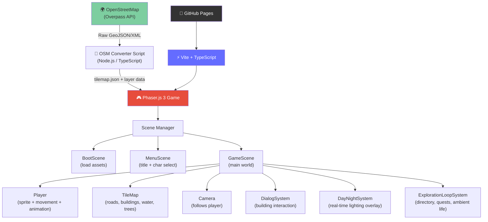
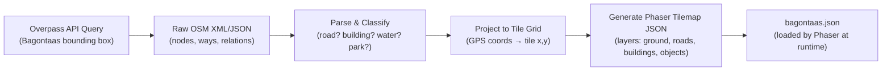

# 🗺️ Bagontaas Explorer — Implementation Plan

## Goal

Build **"Bagontaas Explorer"** — an interactive, browser-based pixel RPG where players roam a faithful pixelated recreation of the real **Bagontaas town center**, with real building/street data sourced from OpenStreetMap, a real-time day/night cycle, character selection, RPG-style building interaction dialogs, and engaging exploration gameplay loops.

This project will be published to GitHub and showcased on LinkedIn to demonstrate frontend craftsmanship, creative problem-solving, game systems design, and unique portfolio value.

---

## User Review Required

> [!IMPORTANT]
> The map data pipeline relies on **OpenStreetMap (OSM) data for Bagontaas**. You will need to confirm the exact GPS bounding box of the section you want (main street / town center). We'll do this together during the map setup phase.

> [!WARNING]
> Asset sourcing (character sprites + tilesets) from **itch.io / OpenGameArt** requires checking individual licenses. All assets must allow free personal/portfolio use. We will verify this before use.

---

## Open Questions

> [!NOTE]
> **Project name** — "Bagontaas Explorer" is the working title. Do you want a different name (something in Filipino/local dialect, or a stylized game title)?

---

## Tech Stack

| Layer | Technology | Why |
|---|---|---|
| **Framework** | Vite + TypeScript | Fast dev server, modern tooling, lightweight output |
| **Game Engine** | Phaser.js 3 | Built-in tilemap, camera follow, sprite animation, physics, input |
| **Map Data** | OpenStreetMap (Overpass API) | Free, real, accurate data for Bagontaas |
| **Map Conversion** | Custom OSM → Phaser tilemap script (Node.js) | Converts real GPS data to a playable tile grid |
| **Styling (UI layer)** | CSS + custom pixel font | Menus, dialog boxes, character select screen, HUD |
| **Audio (Optional)** | Web Audio API / Phaser Sound | Ambient environmental soundscapes (tricycles, day/night ambients) |
| **Deployment** | GitHub Pages (via `gh-pages` npm package) | Free hosting, linked to your GitHub profile |
| **Version Control** | Git — feature branches → main | Clean, professional git history |

---

## Architecture Overview



---

## Proposed Changes / File Structure

```
bagontaas-explorer/
│
├── public/
│   └── assets/
│       ├── sprites/
│       │   ├── characters/        # Player sprite sheets (8-directional isometric walk)
│       │   ├── vehicles/          # Ambient tricycles & motorbikes
│       │   └── tiles/             # Tileset PNG (road, grass, building, water, trees)
│       ├── maps/
│       │   └── bagontaas.json     # Generated Phaser tilemap (from OSM converter)
│       ├── audio/                 # Ambient day/night & village sound effects
│       └── fonts/
│           └── pixel-font.ttf     # Retro pixel font for dialog/UI
│
├── scripts/
│   └── osm-to-tilemap.ts          # OSM data converter → Phaser tilemap JSON
│
├── src/
│   ├── main.ts                    # Vite entry point, Phaser game config
│   ├── config/
│   │   ├── GameConfig.ts          # Phaser config (resolution, physics, scenes)
│   │   └── MapConfig.ts           # OSM bounding box, tile size, zoom level
│   │
│   ├── scenes/
│   │   ├── BootScene.ts           # Preload all assets
│   │   ├── MenuScene.ts           # Title screen + character selection
│   │   └── GameScene.ts           # Main game world
│   │
│   ├── game-objects/
│   │   ├── Player.ts              # Player class (movement, animation, collision)
│   │   ├── BuildingZone.ts        # Interactive building trigger zones
│   │   └── AmbientVehicle.ts      # Moving tricycles / ambient pathing
│   │
│   ├── systems/
│   │   ├── DialogSystem.ts        # RPG dialog box (name, type, interaction prompt)
│   │   ├── DayNightSystem.ts      # Real-time lighting overlay + time-scrubber toggle
│   │   ├── InteractionSystem.ts   # Proximity detection + key press → dialog trigger
│   │   └── DirectorySystem.ts     # Barangay directory & discovery tracker
│   │
│   ├── data/
│   │   ├── buildings.ts           # Building metadata (name, type, trivia, OSM ID)
│   │   └── quests.ts              # Optional mini errands & tasks
│   │
│   └── ui/
│       ├── CharacterSelect.ts     # Character picker UI
│       ├── HUD.ts                 # On-screen HUD (time widget, discovery tracker)
│       └── DirectoryModal.ts      # Town passport / collection modal
│
├── index.html
├── vite.config.ts
├── tsconfig.json
├── package.json
└── README.md
```

---

## Key Systems — Detail

### 1. OSM → Phaser Tilemap Pipeline

This is the most unique and technically impressive part of the project.



**Tile Layer Structure:**
| Layer | Contents |
|---|---|
| `ground` | Grass, dirt, concrete base tiles |
| `roads` | Road tiles (derived from OSM highway tags) |
| `water` | River/creek tiles (OSM waterway tags) |
| `vegetation` | Tree/bush tiles (OSM landuse=forest/park) |
| `buildings` | Building footprint tiles (OSM building tags) |
| `collision` | Invisible layer marking non-walkable tiles |
| `interaction_zones` | Invisible zones near buildings triggering dialog |

---

### 2. Player System

In isometric view, movement is mapped to **8 directions** with **isometric projection**:
- `W` / `↑` → move North-West (up-left on screen)
- `S` / `↓` → move South-East (down-right on screen)
- `A` / `←` → move South-West (down-left on screen)
- `D` / `→` → move North-East (up-right on screen)
- Diagonals: combinations of the above

```typescript
// Player.ts — isometric movement logic
class Player extends Phaser.GameObjects.Sprite {
  private speed = 120;

  update() {
    const left  = cursors.left.isDown  || wasd.A.isDown;
    const right = cursors.right.isDown || wasd.D.isDown;
    const up    = cursors.up.isDown    || wasd.W.isDown;
    const down  = cursors.down.isDown  || wasd.S.isDown;

    // Isometric velocity mapping:
    let vx = 0, vy = 0;
    if (up)    { vx -= 1; vy -= 0.5; }
    if (down)  { vx += 1; vy += 0.5; }
    if (left)  { vx -= 1; vy += 0.5; }
    if (right) { vx += 1; vy += 0.5; }

    // Normalize + apply speed, play matching directional animation
  }
}
```

---

### 3. Day/Night System

```typescript
// DayNightSystem.ts
class DayNightSystem {
  // Get current local time in Bagontaas (PHT = UTC+8)
  getLightLevel(): number {
    const hour = new Date().toLocaleString('en-US', {
      timeZone: 'Asia/Manila', hour: 'numeric', hour12: false
    });
    // Returns alpha value 0.0 (noon) to 0.75 (midnight) for dark overlay
  }

  update(overlay: Phaser.GameObjects.Rectangle) {
    overlay.setAlpha(this.getLightLevel());
  }
}
```

*Includes an instant time-of-day switcher in HUD (Dawn / Noon / Sunset / Night) for quick recruiter / portfolio demonstrations.*

---

### 4. Dialog System

When a player walks near a building and presses **E** or **Space**:

```
┌─────────────────────────────────────────────────────┐
│  🏪  Bagontaas Public Market                        │
│  Type: Market · Commercial                          │
│  "Hub of fresh produce, fish, and morning snacks."  │
│  [⭐ Added to Barangay Directory]       [ E ] Close │
└─────────────────────────────────────────────────────┘
```

---

### 5. Gameplay Loops & Progression (Loop Cycles)

```mermaid
flowchart TD
    subgraph MicroLoop ["1. Exploration Micro-Loop (30s - 2m)"]
        A1["🚶 Roam Town Roads & Alleys"] --> A2["📍 Discover Landmark / Building"]
        A2 --> A3["💬 Open Dialog (E / Space)"]
        A3 --> A4["📖 Unlock in Barangay Directory (+1 Stamp)"]
        A4 --> A1
    end

    subgraph MacroLoop ["2. Atmosphere & Life Loop (5m - 15m)"]
        B1["⏰ Real-Time Clock / HUD Slider"] --> B2["🌅 Visual Shift (Dawn / Noon / Dusk / Night)"]
        B2 --> B3["💡 Window Glow & Streetlamp Activation"]
        B3 --> B4["🛺 Ambient Street Life (Tricycles & Roosters)"]
    end

    subgraph QuestLoop ["3. Barangay Errand Loop (3m - 5m)"]
        C1["🗣️ Talk to Resident NPC"] --> C2["📦 Receive Errand (e.g., Deliver Pandesal)"]
        C2 --> C3["🗺️ Follow Street Signs to Target Landmark"]
        C3 --> C4["🎉 Complete & Unlock 'Honorary Citizen' Title"]
    end
```



#### Loop Cycle 1: The Core Exploration Loop (Micro Loop)
- **Barangay Directory Counter**: HUD displays discovery progress (e.g., `📍 Discovered: 5 / 15 Landmarks`).
- **Stamp Collection / Landmark Dossier**: Each discovered building unlocks a collectible card with trivia, Filipino context, and coordinates.

#### Loop Cycle 2: Ambient Routine & Atmosphere Loop (Macro Loop)
- **Time-Scrubber Controls**: Instant buttons for reviewers: Dawn 🌅, Noon ☀️, Sunset 🌇, Night 🌙.
- **Night Illumination**: Building windows and lampposts emit warm light when night overlay activates.
- **Ambient Street Life**: Tricycles and jeepneys navigate major roads following OSM road coordinates.

#### Loop Cycle 3: Community Errand Mini-Quest (Optional Polish Milestone)
- Simple quest cycle given by a local resident at the plaza to deliver an item across town to promote exploration.

---

### 6. Menu / Character Select Screen

```
┌──────────────────────────────────────────┐
│                                          │
│       🗺️  BAGONTAAS EXPLORER             │
│         Explore the Pixel Town           │
│                                          │
│   ◄  [Character 1]  [Character 2]  ►    │
│         [Character 3]  [Character 4]     │
│                                          │
│              [ START ]                   │
│                                          │
└──────────────────────────────────────────┘
```

---

## Build Schedule (2 Weeks)

### Week 1 — Core Systems

| Day | Task |
|---|---|
| **Day 1** | Project setup: Vite + TypeScript + Phaser.js + ESLint + `gh-pages` |
| **Day 2** | OSM data fetch: query Overpass API for Bagontaas bounding box, export raw data |
| **Day 3** | Build OSM → Phaser tilemap converter script, generate `bagontaas.json` |
| **Day 4** | Load tilemap in Phaser, render tile layers, verify map looks correct |
| **Day 5** | Player class: sprite loading, WASD/arrow movement, 8-direction isometric animations |
| **Day 6** | Camera follow + collision layer (player can't walk through buildings/walls) |
| **Day 7** | Buffer / fixes from Week 1 |

### Week 2 — Features & Polish

| Day | Task |
|---|---|
| **Day 8** | Building interaction zones + DialogSystem + Barangay Directory discovery tracker |
| **Day 9** | Day/Night overlay system (real-time clock + demo time toggle) + night lighting |
| **Day 10** | Menu screen + Character Selection scene |
| **Day 11** | Ambient street life: moving tricycles along roads + asset styling polish |
| **Day 12** | Deploy to GitHub Pages, verify live link works |
| **Day 13** | Record demo video (OBS/Loom), write README + LinkedIn post |
| **Day 14** | Publish to LinkedIn 🚀 |

---

## Git Branch Strategy

```
main (production — always deployable)
│
├── feature/project-setup
├── feature/osm-tilemap-pipeline
├── feature/player-movement
├── feature/building-interactions
├── feature/day-night-system
├── feature/menu-character-select
└── feature/polish-deploy
```

---

## Asset Plan

| Asset | Source | License |
|---|---|---|
| Character sprites | itch.io (free RPG packs) or LPC on OpenGameArt | Verify CC0 / CC-BY |
| Tileset (roads, grass, buildings) | LPC Base Assets (OpenGameArt) | CC-BY-SA 3.0 |
| Pixel font | Press Start 2P (Google Fonts) | OFL (free) |
| Map data | OpenStreetMap (Overpass API) | ODbL (free, open) |

---

## LinkedIn Post Strategy

**Hook:** *"I built an RPG game out of my hometown — and it runs in your browser."*

**Content:**
- 30-second screen recording of the character walking around the pixel town
- Screenshot of the dialog box appearing over a real building
- Screenshot of the night mode (dark overlay, atmospheric)
- Showcase of the Barangay Directory stamp system and time scrubber
- Tech used: Vite · TypeScript · Phaser.js · OpenStreetMap API
- GitHub link + live demo link

---

## Visual Design Direction ✅

### View Angle
**Isometric** — 45° camera angle. Buildings have height/depth. World feels 3D rendered in 2D isometric pixel art.

### Color Palette — Vibrant Tropical Filipino

| Element | Color Direction |
|---|---|
| **Sky/background** | Warm soft blue (tropical daytime sky) |
| **Ground/roads** | Warm concrete gray with subtle detail |
| **Grass/parks** | Rich tropical green |
| **Trees** | Lush green bubble-top trees, vibrant |
| **Buildings (generic)** | Warm cream/white with colored rooftops |
| **Key landmarks** | Accent colors — warm orange, sky blue, coral red |
| **Water/creek** | Bright tropical turquoise-blue |
| **UI panels** | Clean white with soft shadow, pixel font |
